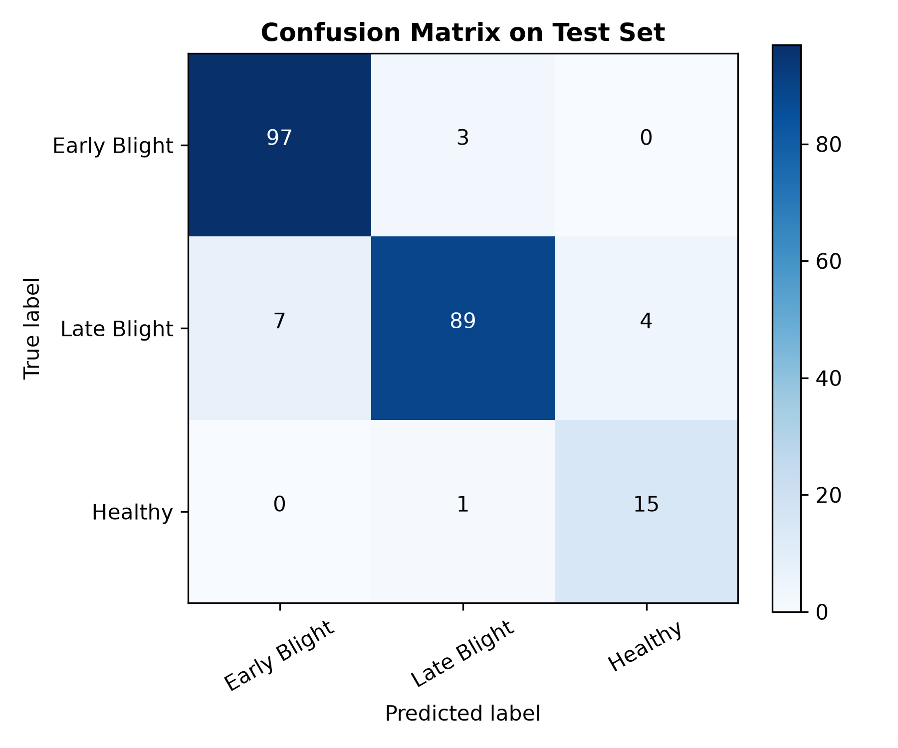
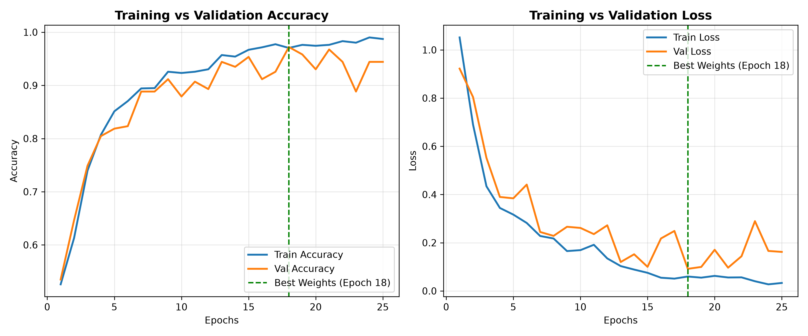

# Potato Disease Classification using CNN

An end-to-end computer vision project to classify potato leaf images into **Early Blight**, **Late Blight**, or **Healthy** using a Convolutional Neural Network (CNN) built with TensorFlow/Keras and deployed via Streamlit.

---

## Evaluation & Measured Results

The model was evaluated on a held-out, leak-free test set of 216 images created via stratified 80/10/10 file-level partitioning:

- **Test Accuracy**: **93.06%** (201 / 216 images correct)
- **Macro-F1 Score**: **0.910**
- **Test Loss**: 0.1556

> **Note on Sample Size**: A 216-image test set has roughly a 3 to 4 point margin of error.

The old result came from a split that could leak test images.

### Per-Class Performance Table

| Class | Support | Precision | Recall | F1-Score |
| :--- | :---: | :---: | :---: | :---: |
| **Early Blight** (`Potato___Early_blight`) | 100 | 0.933 | 0.970 | 0.951 |
| **Late Blight** (`Potato___Late_blight`) | 100 | 0.957 | 0.890 | 0.922 |
| **Healthy** (`Potato___healthy`) | 16 | 0.789 | 0.938 | 0.857 |
| **Macro Average** | **216** | **0.893** | **0.933** | **0.910** |
| **Weighted Average** | **216** | **0.933** | **0.931** | **0.931** |

---

### Confusion Matrix



*Confusion matrix on the 216-image test set (raw counts).*

---

### Training & Validation Curves



*Training and validation loss and accuracy curves across epochs, with early stopping at epoch 25 (best checkpoint restored from epoch 18).*

---

## Installation & Local Execution

### Prerequisites
- Python 3.12 (matches production environment)
- Virtual environment tool (`venv`)

### 1. Clone & Set Up Virtual Environment

```bash
git clone https://github.com/Vinay-1105/Potato-Plant-Disease-Classification-model-Using-CNN.git
cd Potato-Plant-Disease-Classification-model-Using-CNN

python -m venv .venv
# Windows:
.\.venv\Scripts\activate
# Linux/macOS:
source .venv/bin/activate
```

### 2. Install Dependencies

Install production requirements for the Streamlit app:
```bash
pip install -r requirements.txt
```

*(Optional) For notebook development and re-running evaluations, install development packages:*
```bash
pip install -r requirements-dev.txt
```

### 3. Run the Streamlit Application

```bash
streamlit run app.py
```

The application will be accessible in your web browser at `http://localhost:8501`.

---

## Reproduce

To reproduce the pipeline (data audit, leak-free split, perceptual hash near-duplicate check, training, test evaluation, and threshold calibration):

### 1. Download Dataset
- **Dataset Source**: [Kaggle PlantVillage Dataset (emmarex/plantdisease)](https://www.kaggle.com/datasets/emmarex/plantdisease)
- Extract the 3 potato classes into `dataset/PlantVillage/`:
  - `dataset/PlantVillage/Potato___Early_blight/` (1,000 images)
  - `dataset/PlantVillage/Potato___Late_blight/` (1,000 images)
  - `dataset/PlantVillage/Potato___healthy/` (152 images)
  - **Total**: 2,152 images.

### 2. Install Development Dependencies
```bash
pip install -r requirements-dev.txt
```

### 3. Execute Pipeline Scripts

1. **Data Split & Near-Duplicate Check**:
   ```bash
   python training/01_split_and_phash.py
   ```
   Performs the stratified 80/10/10 split (seed 42), computes 64-bit perceptual hashes, checks for test duplicates, and generates `training/splits.json`.

2. **Model Training** (optional; trained model is provided as `model_v2.keras`):
   ```bash
   python training/02_train.py
   ```
   Trains the baseline CNN with balanced class weights and early stopping, restoring best weights at epoch 18.
   > **Note**: Retraining with the same seed on CPU may not give bit-identical weights. The reported results come from the committed `model_v2.keras`, and `03_evaluate.py` reproduces them.

3. **Test Evaluation & Metrics Reproduction**:
   ```bash
   python training/03_evaluate.py
   ```
   Evaluates `model_v2.keras` on the 216 test images, reproducing 93.06% accuracy, macro-F1 of 0.910, the confusion matrix, and assets.

4. **Confidence Threshold Analysis**:
   ```bash
   python training/04_threshold_analysis.py
   ```
   Evaluates validation and test sets across thresholds (0.6, 0.7, 0.8, 0.9).

---

## Deployment

The application is configured for deployment on **Streamlit Community Cloud**.

When deploying:
1. Select repository and branch `CNN`.
2. Main file path: `app.py`.
3. Select **Python 3.12** in advanced settings to match pinned package wheels.

---

## Limitations

- **Lab-Style Dataset**: The model is trained on the PlantVillage dataset, which consists of detached leaves photographed against uniform, controlled backgrounds rather than natural field settings.
- **Class Imbalance in Ground Truth**: The `Healthy` class contains only 152 images in total (16 in the test set) compared to 1,000 images each for Early Blight and Late Blight.
- **Potential Subject Duplication in Source**: In the PlantVillage collection, multiple photographs may depict the same physical leaf under slight angle variations, meaning reported evaluation scores may be optimistic.
- **Not Field-Tested**: The model has not been validated on unconstrained, in-field farm photographs with complex backgrounds, direct sunlight, pests, or secondary infections.
- **Out-of-Scope Detection**: The confidence threshold does not detect non-potato images. Synthetic non-potato test images were still assigned a disease class (one with 100% confidence, another with 66%), so the app is only valid for potato leaf photos.
- **Educational Scope**: This project is an academic learning demonstration, not an agronomic diagnostic tool. Agricultural decisions should always involve consultation with plant pathology experts.
